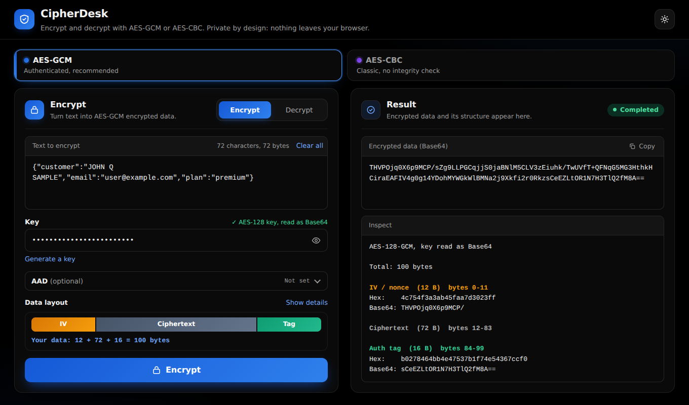
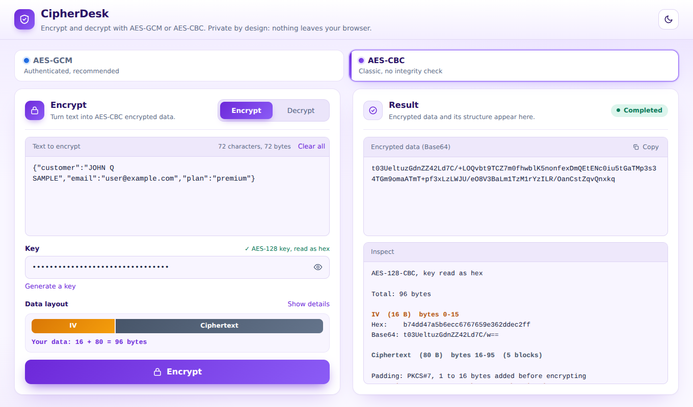

# CipherDesk

Encrypt and decrypt text with **AES-GCM** or **AES-CBC**, entirely in your browser.
Nothing is uploaded, nothing is stored, and there is no server: it is a single static
`index.html` file that uses the browser's built-in Web Crypto API.

<p align="center">
  <a href="https://mba90.github.io/cipherdesk/"></a>
</p>

**Live app: [https://mba90.github.io/cipherdesk/](https://mba90.github.io/cipherdesk/)** (click to open it in your browser, nothing to install)

[](https://mba90.github.io/cipherdesk/)

## Features

- **Two algorithms, two colors.** AES-GCM (blue) is authenticated and recommended.
  AES-CBC (violet) is the classic mode and has no integrity check.
- **Encrypt and Decrypt** with side by side panels, aligned input and output boxes, and no page scrolling on desktop.
- **Smart keys.** Paste a key as Base64, hex or plain text (16, 24 or 32 bytes). The tool reads it for you and shows how, for example "AES-128 key, read as Base64".
- **Inspect report.** After encrypting you see the IV, ciphertext and tag with their byte ranges, in hex and Base64.
- **AAD support** for AES-GCM, with a one-click "Use current time" timestamp.
- **Clear errors** and live size hints (characters, bytes, decoded bytes).
- **Dark by default**, light theme on request. The palette follows the chosen algorithm.
- **Copy** button, JSON syntax colors, keyboard shortcut (Ctrl or Cmd + Enter), arrow-key tab navigation.
- **Private by design.** The only thing saved in your browser is your theme choice.



## Data formats

Both modes produce one Base64 value:

| Mode    | Layout                                    | IV       | Tag      |
|---------|-------------------------------------------|----------|----------|
| AES-GCM | `IV (12 bytes) + ciphertext + tag (16)`   | 12 bytes | 16 bytes |
| AES-CBC | `ciphertext (PKCS#7)` only      | the key (16 bytes) | none     |

- **AES-GCM:** the IV is random for every encryption, so the same text never encrypts to the same output twice.
- **AES-CBC:** works exactly like Java's `AES/CBC/PKCS5Padding` with `new IvParameterSpec(new String(key, UTF_8).getBytes(UTF_8))`. The key is the Base64-decoded secret and **the IV is always the key**, so no IV is stored in the data. The key must be 16 bytes of valid UTF-8 text. The tool follows Java's errors too: a wrong IV length, `BadPaddingException` for a wrong key, `IllegalBlockSizeException` for a bad data length.
- AES-GCM also authenticates an optional **AAD** value. It is **not** stored in the data: you must supply the same AAD to decrypt.
- AES-CBC does not detect wrong keys or changed data reliably. Prefer AES-GCM when you can.
- Decryption accepts Base64 or hex input, and Base64 keys, hex keys and plain-text keys.

## Use it

Open the [live app](https://mba90.github.io/cipherdesk/), or run it locally: there is nothing to build.

```bash
git clone https://github.com/MBA90/cipherdesk.git
cd cipherdesk
npx serve .          # or just open index.html in a browser
```

## Deploy to GitHub Pages

This repository deploys itself with GitHub Actions on every push to `main`.

1. Create an empty repository on GitHub (for example `cipherdesk`).
2. Push this folder to it (commands below).
3. In the repository go to **Settings → Pages → Build and deployment → Source** and choose **GitHub Actions**.
4. Open the **Actions** tab. When the "Test and deploy to GitHub Pages" run finishes, your site is live at
   `https://MBA90.github.io/<repository>/`.

```bash
git init -b main
git add .
git commit -m "Add CipherDesk"
git remote add origin https://github.com/MBA90/cipherdesk.git
git push -u origin main
```

The workflow first runs the tests. The site is only published if they pass.

## Tests

```bash
npm ci
npm test
```

The suite uses [jsdom](https://github.com/jsdom/jsdom) and Node's own `crypto` module, and checks that
Node can decrypt what the page encrypts (and the other way round) for AES-GCM and AES-CBC, plus validation,
tab behavior, accessibility attributes and the per-algorithm themes. It only uses made-up sample data.

## Security notes

- Everything runs locally with the Web Crypto API (`crypto.subtle`). Open the browser's network tab to verify that nothing is sent anywhere.
- Treat keys like passwords. Do not paste real secrets on a computer you do not trust.
- The page loads two web fonts from Google Fonts when online. If you prefer zero outside requests, remove the three `fonts.googleapis.com` / `fonts.gstatic.com` lines from the `<head>` of `index.html`. The page then uses your system fonts.
- Safari does not support AES-192 keys. Use 16 or 32 byte keys there.

## License

MIT. See [LICENSE](LICENSE).
